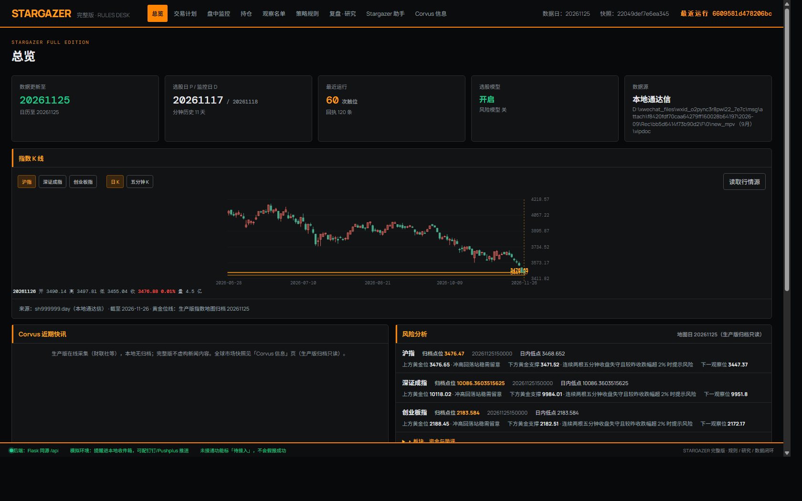
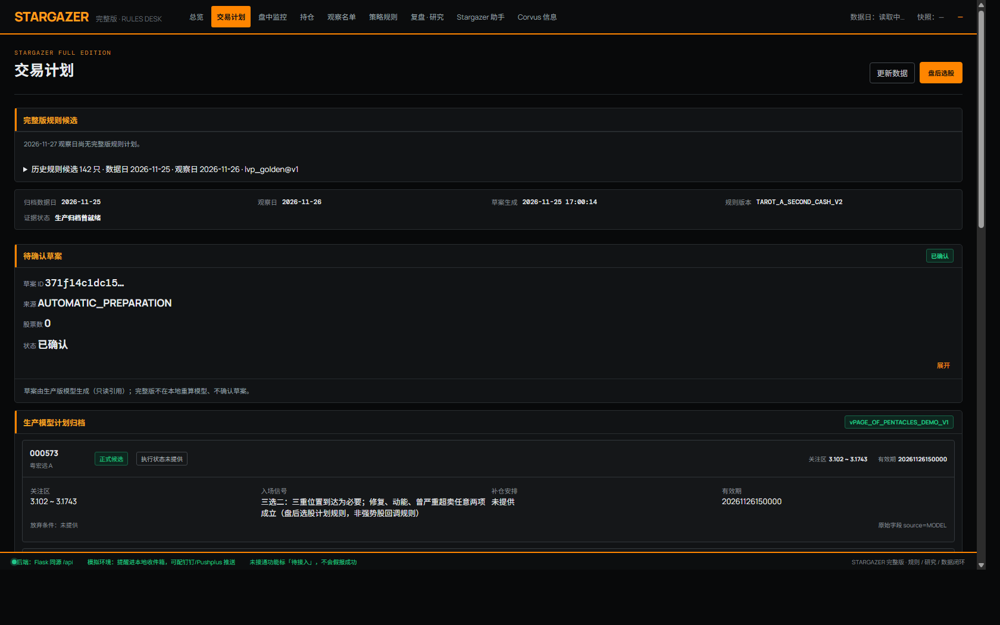
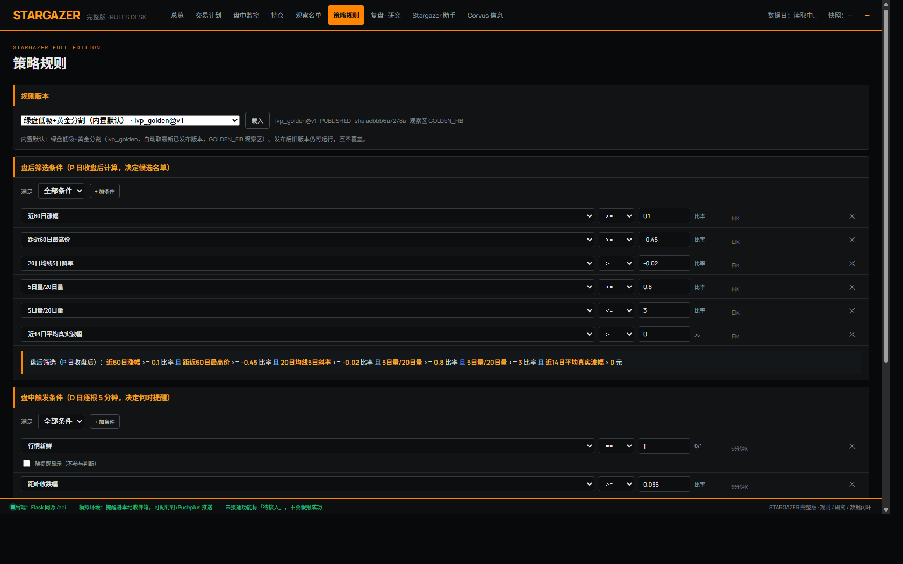
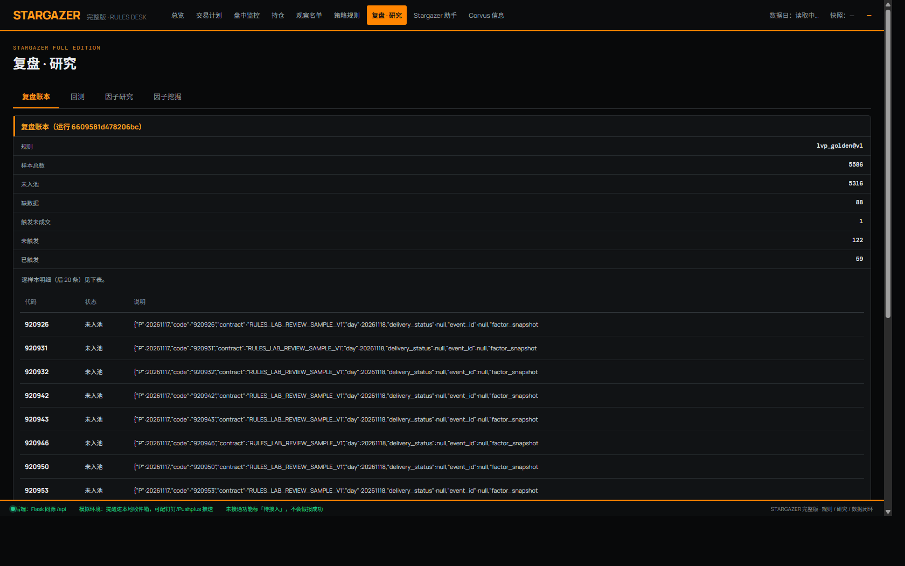
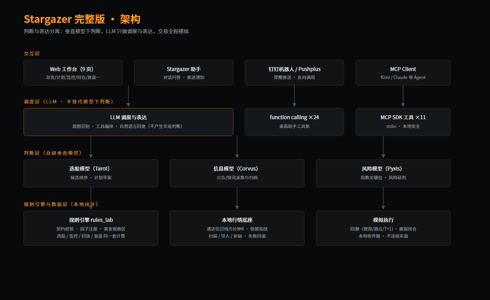

<div align="center">

# Stargazer · A股智能盯盘助手

**盘后选股 → 交易计划 → 盘中提醒 → 复盘研究，一条链路本地闭环**

[](https://www.python.org/)
[](https://flask.palletsprojects.com/)
[](https://modelcontextprotocol.io/)
[](https://www.microsoft.com/windows)
[](#-免责声明)

*判断与表达分离：垂直模型下判断，LLM 只做调度与表达，交易全程模拟*

</div>

---

## 📸 界面预览

| 总览（指数K线 · 黄金位 · 风险分析） | 交易计划（模型计划 · 关注区） |
| :---: | :---: |
|  |  |
| **策略规则（可视化编辑 · 人话预览）** | **复盘 · 研究（回测 · 因子）** |
|  |  |

## 🏗️ 架构



**设计原则：判断与表达分离。** 选股、信息、风险三类判断分别由自研垂直模型承担；
LLM 只负责工具编排与自然语言交互，**不参与定价类决策**，从架构上规避大模型幻觉影响交易判断。

## ✨ 功能特性

- 📈 **盘后选股** — 规则引擎全市场筛选（~5500 只 / 约 2–3 分钟），内置「绿盘低吸+黄金分割」；
  黄金分割观察区 = 确认波段（端点前后各 2 根 K 线验证）+ 斐波那契回撤位
- 📋 **交易计划** — 生效计划 / 待确认草案分开展示；关注区、入场信号、有效期逐卡呈现；
  监控板块强势股池（多级黄金观察区）
- 🔔 **盘中监控** — 逐根已收盘 5 分钟 K 线判定触发；缺数据标「待核验」、补齐后重判；
  event 级幂等，已送达提醒绝不重复；钉钉机器人 / Pushplus 推送
- 💼 **持仓与观察名单** — 模拟持仓浮动盈亏（每笔等额模拟）、观察条目（目标价/止损/策略）
- 🔬 **复盘研究** — 信号回测（佣金/滑点/印花税、T+1、资金曲线）、单因子 Rank IC、
  因子组合挖掘（嵌套留出防前视，候选过门槛才晋级）
- 🛠️ **规则工作台** — 指标分组下拉（中文标签+单位+所需窗口）、条件实时转自然语言、
  预览差异（新增/移除名单带指标值）、版本化发布；已冻结计划永远绑定原版本
- 🤖 **智能助手** — 本地知识库问答（用法/概念/当前状态）、推送通知查询
- 💾 **数据闭环** — 本地通达信数据快照化（指纹校验），扫描/导入/联网补缺，
  失败保留上一份有效快照；数据源可切换（通达信 / StockDB）

## 🚀 快速开始

**环境要求**：Windows · Python 3.10+ · 本地通达信数据（vipdoc）

```bat
git clone https://github.com/4drian1/stargazer-full-edition.git
cd stargazer-full-edition
start.bat
```

首次运行自动创建隔离环境并安装依赖（flask / pandas / numpy / pyarrow / scikit-learn），
随后浏览器打开 `http://127.0.0.1:17891`。

也可以直接下载打包好的试用程序（免装 Python）：
[**Release v1.0.0 · StargazerFullTest.exe**](https://github.com/4drian1/stargazer-full-edition/releases/latest)

**数据准备**：程序默认读取本地通达信 vipdoc 目录（页面「数据来源」可修改路径）；
首次使用构建数据快照：

```bash
python -m full.build_snapshot
```

## 📁 项目结构

```
full/        应用层：Web UI（9 页）、推送、指数K线、强势池、助手、数据闭环
rules_lab/   规则引擎：契约校验、因子注册、选股/监控/回放/复盘内核（同一套计算）
rules/       内置规则种子（绿盘低吸+黄金分割 等）
tests/       回归测试（截点防前视 / 中断续跑零重复 / 缺数兜底 / 黄金区）
tools/       辅助工具
reports/     验收报告
docs/        架构图与界面截图
```

## 🧪 工程保障

- 历史回放与盘中判定**共用同一套因子计算**，杜绝口径分叉
- 每次运行绑定**快照指纹**，可复现、可审计
- 多组回归：盘前截点防前视、进程中断续跑回执零重复、数据缺口兜底、黄金区边界
- jsdom 真实渲染冒烟：9 个页面逐页点击验证

## ⚠️ 免责声明

本项目为个人学习与研究用途，所有交易动作均为**本地模拟**，不连接券商实盘，
不构成任何投资建议。市场有风险，投资需谨慎。
